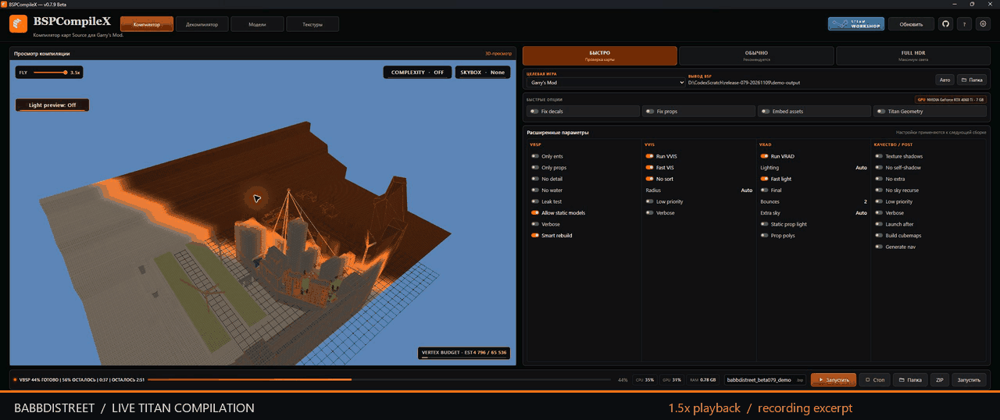
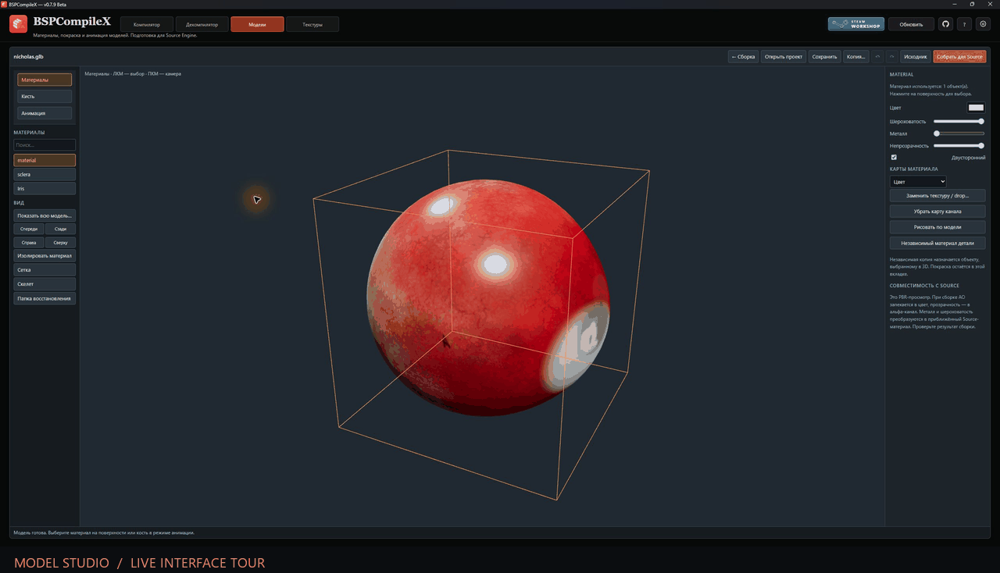
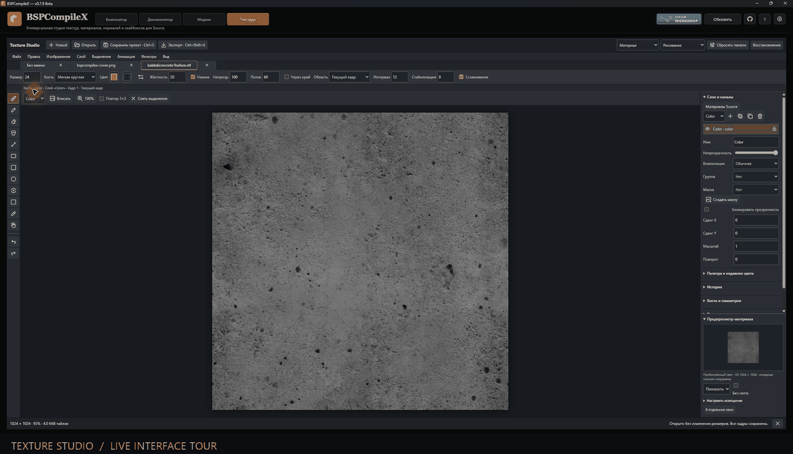

<h1 align="center">BSPCompileX</h1>

<strong>Build the map. Shape the assets. See what happens.</strong>

  

Babbdistreet · real live compilation excerpt · overhead camera · 1.5× playback

  
  
  

  <a href="#start-building">Quick start</a> ·
  <a href="#explore-the-workspace">Workspace</a> ·
  <a href="RELEASE-0.7.9.md">Everything new since 0.7.8</a> ·
  <a href="BENCHMARKS.md">CompilePal comparison</a> ·
  <a href="https://github.com/D3cort/BSPCompileX/releases/tag/v0.7.8-beta">0.7.8 fallback</a>

**BSPCompileX** brings Source map compilation, BSP decompilation, model conversion and texture editing into one native Windows application. Drop a VMF, inspect it in 3D, select a build mode and follow the real compiler output.

**Для русскоязычных пользователей:** 0.7.9 Beta добавляет новые редакторы моделей и текстур, диагностику ошибок с переходом к объектам и исправления декомпиляции. Первый GIF показывает вашу Babbdistreet с обзорного ракурса, с ускорением 1,5×.

## Start building

1. **[Download 0.7.9 Beta](https://github.com/D3cort/BSPCompileX/releases/download/v0.7.9-beta/BSPCompileX-0.7.9-Beta-20261109-Windows-x64.exe)** — one EXE, signed by D3cort.
2. Select **Garry's Mod** and drop a `.vmf` into the Compiler workspace.
3. Choose **Fast**, **Normal** or **FullHDR**, then select your output folder.
4. Press **Start**. Inspect progress, logs and map diagnostics as the tools run.

[SHA-256 checksum](https://github.com/D3cort/BSPCompileX/releases/download/v0.7.9-beta/BSPCompileX-0.7.9-Beta-20261109-Windows-x64.sha256.txt) · [Release notes](RELEASE-0.7.9.md) · [Report an issue](https://github.com/D3cort/BSPCompileX/issues)

## Explore the workspace

| **COMPILE & INSPECT** | **RECOVER & DIAGNOSE** |
|---|---|
| Live VMF/BSP preview, GPU adapter selection, build presets and Smart Rebuild. Titan Geometry converts oversized detail geometry into packed Source models. | Native BSP decompiler, embedded-content extraction, material-path restoration and map-protection warnings. Compiler advice can locate problem objects and leak paths. |
| **MODEL STUDIO · BETA** | **TEXTURE STUDIO · BETA** |
| Material channels, 3D/UV painting, layers, masks, bones, animation keys and `.cxmodel` projects. Build supported assets for Source through StudioMDL. | Painting, selections, procedural materials, layers, masks, animated frames and `.cxtx` projects. Export PNG/GIF sequences or VTF/VMT materials. |

<table>
<tr><td width="50%"><strong>Model Studio</strong> </td><td width="50%"><strong>Texture Studio</strong> </td></tr>
</table>

<strong>▸ Compiler — preview, lighting and large maps</strong>

- Native Direct3D preview with Direct3D 11 / WARP fallback paths.
- CPU and memory budgets, GPU adapter selection and configurable Source tool flags.
- Titan geometry conversion, model validation, HDR/LDR lighting and embedded assets.
- Smart Rebuild for compatible changes; full rebuild when cache validation requires it.
- `Home` in the focused viewport frames the map from above. Skybox None/Mesh/Show changes the preview.

<strong>▸ Decompiler — corrected geometry and content</strong>

0.7.9 fixes displaced surfaces being attached to unrelated brush sides and restores translated brush-entity geometry to its proper location. Exported IDs and entity connections are validated. Known protection signatures produce warnings.

Compiled Titan geometry remains model geometry: extract its embedded models and make them available to Hammer. A compiled BSP cannot promise the original editable brush history.

<strong>▸ Model & Texture Studio — projects and editing</strong>

Work with project files, revisions, undo/redo and autosave recovery. Model materials, painting and animation belong to the Model workspace; texture documents, animated frames and material-channel editing belong to Texture Studio. See the [complete Beta feature list and limitations](RELEASE-0.7.9.md).

<strong>▸ Downloads, protection and requirements</strong>

**Primary tested workflow:** Windows 10/11 x64 with Garry's Mod x64 compiler tools installed. The application uses a static C/C++ runtime; Python and Java are not required for map compilation or decompilation. Video import additionally needs Windows Media Foundation and a supported codec.

Both downloadable versions use the encrypted, authenticated single-file runtime and additional [BLA](https://github.com/qybaihe/bla) artifact hardening. The final files are signed and checksummed. This increases resistance to automated analysis; it is not a guarantee that reverse engineering is impossible.

**0.7.9 is Beta.** The full studio development plans are not complete. Other Source game profiles show their validation status inside the app.

## Performance, honestly measured

| Question | Answer |
|---|---|
| Is the GIF real? | Yes: an overhead recording of Babbdistreet compiling, played at 1.5×. |
| Does the GIF show total build time? | It is a continuous excerpt, not a complete benchmark run. |
| Is BSPCompileX faster than CompilePal? | No matched head-to-head speed ratio has been measured for this release. |
| What differs? | An integrated live preview, native decompiler, Beta asset editors and Titan recovery; CompilePal documents packing, batch compilation and custom steps/plugins. |

[Read the comparison and reproducible timing method →](BENCHMARKS.md)

## Releases

| Version | Purpose | Download |
|---|---|---|
| **0.7.9 Beta** | New workspace and studios, diagnostics and decompiler fixes | [EXE + checksums](https://github.com/D3cort/BSPCompileX/releases/tag/v0.7.9-beta) |
| **0.7.8** | Previous version, repackaged with additional BLA hardening | [Fallback release](https://github.com/D3cort/BSPCompileX/releases/tag/v0.7.8-beta) |

## License

**Proprietary freeware by D3cort.** See [LICENSE.txt](LICENSE.txt). This repository contains public release information and demonstrations; application source code is not included in the download.
