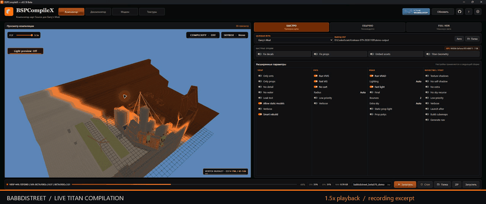

# BSPCompileX 0.7.9 Beta

**Build the map. Shape the assets. See what happens.**

Real Babbdistreet compilation from an overhead camera: a continuous excerpt at **1.5× playback**, not a timing benchmark.

**Новая Beta:** обновлённый интерфейс, Model Studio и Texture Studio, диагностика компилятора и исправления геометрии декомпилятора. Полный список изменений после 0.7.8 приведён ниже.

## Since 0.7.8

### Workspace

- WebView2 workspaces for compilation, decompilation, model and texture tools.
- Consistent drag-and-drop and native file selection.
- Separate logs and documents for each workspace.
- Remembered output folders and names with collision-safe destination handling.
- Localized interface, tooltips, internal messages, licence acceptance and Settings licence page.
- Original external SDK messages remain available for accurate diagnostics.
- Confirmation before closing with a compilation, conversion or download in progress.

### Compiler and Titan Geometry

- Live native VMF/BSP preview of geometry, materials, displacements and props.
- Direct3D 12 with Direct3D 11 and WARP fallback paths.
- GPU adapter selection and CPU/memory budgets for the compiler process tree.
- Fast, Normal and FullHDR presets with configurable Source tool options.
- Smart Rebuild validation against source contents and compilation settings.
- Cached lighting reuse for compatible changes, with full lighting fallback.
- Titan recovery for oversized detail geometry through native static-model conversion and embedded assets.
- 64-bit StudioMDL preference, bounded retries and geometry/model integrity checks.
- World/prop lighting passes, HDR/LDR validation and VHV integrity checks.
- Exact generated-vertex stitching and retained-prop lighting validation.
- Temporary VMF copies for retries and automatic repairs.
- More accurate progress during long FullHDR static-prop stages.
- Fixed generated-model loading with Cyrillic TEMP paths using real ASCII mount-session paths.
- `Home` in the focused viewport frames the map from above under a diagonal angle. Skybox None/Mesh/Show changes the preview.

### Decompiler

- Native BSP-to-VMF export, embedded-content extraction and material-path restoration.
- Detection of known protection signatures; heuristic results are labelled uncertain.
- Validation of unique entity, solid and side IDs.
- Preserved duplicate entity outputs and connection separators.
- Correct world positioning of translated brush-model entities.
- Displacements reconstructed from actual quad render faces, rather than unrelated brush sides sharing a plane.
- Higher precision for exported coordinates and texture axes.
- Regression checked on Babbdistreet: both displacement surfaces survive export, and stock VBSP recompiles the result with extracted content without missing studio-model errors.

**Recovery limits:** compiled BSPs do not retain every editor object. Titan geometry remains model props in the export; extract those models and make them available to Hammer. A model cannot promise the original editable brush history.

### Model Studio — Beta

- Versioned `.cxmodel` documents, revisions, undo/redo and autosave recovery.
- Material selection in 3D and lists, isolation and comparison with the source.
- Material properties, separate channel maps, drag-and-drop replacements and independent copies.
- Painting in 3D or UV with layers, masks and colour sampling.
- Skeleton and bone selection, transform tools and numeric local transforms.
- Temporary poses, animation keys, optional auto-key and timeline editing.
- Pose library and confirmed-revision Source export workflow.
- Common mesh imports, skeletons, animation clips and LOD conversion.
- Source model generation through StudioMDL, PBR-channel conversion and supported jointed collision.

### Texture Studio — Beta

- `.cxtx` projects with layers, masks, frames and animation keys.
- Atomic saves, checkpoints, undo/redo, recovery and older-project migration.
- Painting tools, selections, transformations and material-channel editing.
- Procedural materials and masks with deterministic seeds.
- Normal, height, AO and roughness workflows with 2D/3D previews.
- Plane, sphere and cube previews; configurable and detachable panels.
- Animated GIF/VTF import, image sequences and explicit frame timing.
- Frame reorder, duplicates, ranges, reverse, ping-pong and retiming.
- Time-based playback, onion skin and current/selected/all-frame editing.
- Linear/step/smooth animation interpolation and baking.
- PNG, GIF, PNG sequence and VTF/VMT export.
- Source compression, mipmap, shader and alpha options.

### Content, diagnostics and support

- Explicit content directories and shared resolution across compilation and packing.
- Safer Unicode-path handling around legacy Source tool constraints.
- Embedded-content deduplication and conflict-preserving extraction.
- Timestamped logs, build IDs and support reports.
- Explanations for common Hammer/Source errors.
- Navigation to matching objects, missing assets and current leak pointfiles.
- Editable-VMF versus compiled-BSP ZIP packaging workflows.

### Release protection

- One EXE containing an AES-256-CBC encrypted, HMAC-SHA256 authenticated runtime.
- Additional [BLA 3.2.1](https://github.com/qybaihe/bla) artifact hardening, applied before the final D3cort signature.
- ASLR, high-entropy VA, NX, CFG and CET launcher protections.
- SHA-256 checksums for the final downloadable files.
- Both 0.7.8 and 0.7.9 receive the additional artifact hardening.
- BLA structural verification and actual runtime tests are separate. Structural scores do not establish that reverse engineering is impossible.

## Verification

- 10 targeted native CTest checks passed.
- Geometry regression fails on the previous exporter and passes on the corrected exporter.
- Both Babbdistreet displacement surfaces are exported.
- Recompilation with the extracted content succeeds without missing studio models.
- Final BLA-protected, signed 0.7.9 exports the supplied BSP successfully.
- Original and protected 0.7.8 pass the selected native runtime checks.
- Final signatures, checksums and temporary-runtime cleanup checked.

## Beta scope

The primary tested workflow is Windows 10/11 x64 with Garry's Mod x64 compiler tools. Other Source profiles show their validation status in the application. New studio tools remain Beta, and their full development plans are not complete.

The GIF is a real recording excerpt, not total build time. No unmeasured speed multiplier against CompilePal is claimed. See [performance methodology and comparison](BENCHMARKS.md).

## Downloads

- [0.7.9 Beta](https://github.com/D3cort/BSPCompileX/releases/tag/v0.7.9-beta)
- [0.7.8 fallback, repackaged with BLA](https://github.com/D3cort/BSPCompileX/releases/tag/v0.7.8-beta)

Developer: **D3cort** · Proprietary freeware · Application source code is not included in the download.
